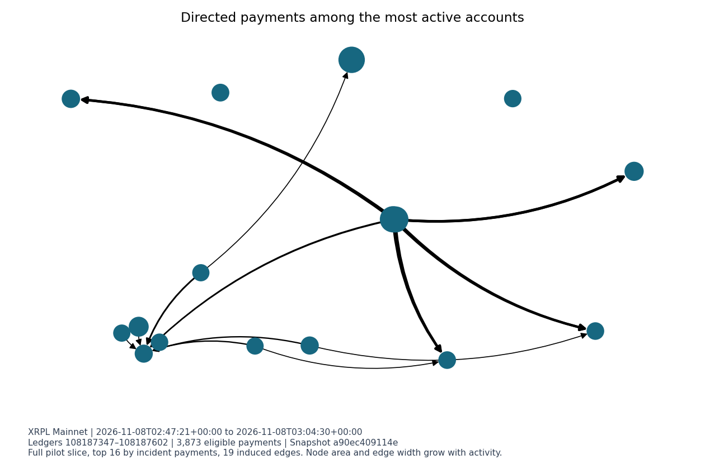
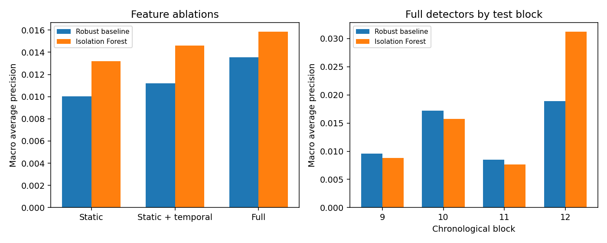
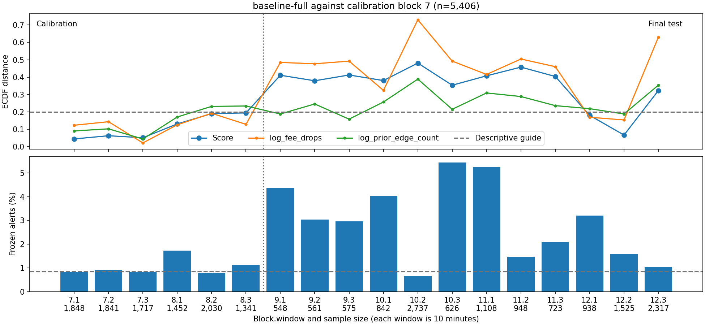
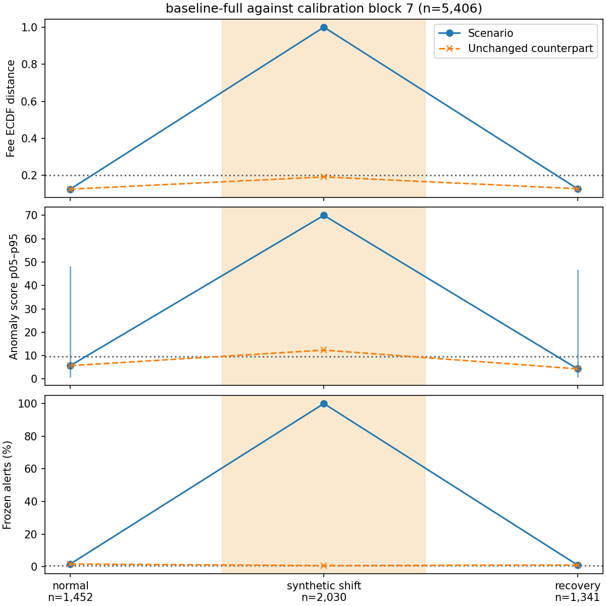

# XRP Ledger Anomaly Detection — End-to-End ML Systems

End-to-end ML system for XRP Ledger transaction anomaly detection, featuring temporal and graph-based features, reproducible model evaluation, FastAPI inference, Docker, CI, and drift monitoring.

A local Python system that scores unusual XRP payments from validated Mainnet ledgers. XRPL provides public, ordered transaction history with exact integer amounts and a directed payment graph. This makes it possible to replay what the scorer could have known at each ledger and to measure how the models behave as activity changes over time.

```text
Read-only XRPL RPC → hash-checked ledger cache → normalized SQLite payments
  → chronological replay of 21 features → calibrated scorer → FastAPI
  → local request metrics and offline drift reports
```

The main engineering work is recovering from interrupted acquisition, preserving integer drops and ledger order, excluding same-ledger and future activity from features, and carrying the exact calibration rule into serving. The core uses Python and SQLite. Matplotlib renders the evaluation figures, MLflow tracks the frozen experiment locally, and the repository includes a pinned Docker build and a GitHub Actions workflow.

## Results

The robust statistical baseline is the operational reference. The full Isolation Forest comparison gained 0.00233 macro average precision on held-out synthetic interventions, and the advantage reversed when the last test block was excluded. Forest recall was lower under both evaluated alert policies. The original Mainnet payments are unlabeled, so the evaluation measures sensitivity to controlled changes. It supplies no real-fraud accuracy estimate.

Offline monitoring detected a large synthetic fee shift. Natural historical variation also frequently crossed the 0.20 empirical CDF distance guide, including forest scores in unchanged windows. The guide is descriptive. See the [technical audit](docs/phase5-audit.md) for the numerical results, figure provenance and verification boundaries.

## Figure gallery



**Payment network.** The November 8, 2026 UTC pilot contained 3,873 eligible payments. The graph shows 19 directed edges among the 16 accounts with the most incident payments in that slice. Node area and edge width encode payment counts. See the [pilot specification](docs/specification.md#reproduce-the-phase-2-pilot).



**Held-out synthetic evaluation.** Macro average precision compares the robust baseline with Isolation Forest on synthetic interventions in blocks 9–12. The panels use different vertical scales. Block 12 accounts for the forest's mean advantage with the full feature set. See the [held-out comparison](docs/phase3b3.md#synthetic-test-comparison).



**Historical monitoring.** Eighteen unchanged ten-minute Mainnet windows contain 23,677 observations. The upper panel compares feature and score distributions against block 7, which overlaps its own reference. The lower panel shows alert rates under the frozen rule. The 0.20 distance guide is descriptive.



**Synthetic shift and recovery.** In the shaded block 8 window, the fee feature represents a fixed 100,000 drops for all 2,030 rows. The dashed orange line shows the same rows with their original fees. The next window uses unchanged observations. Score markers are medians and bars show the 5th–95th percentiles. See the [monitoring results](docs/phase4d.md#historical-behavior-and-controlled-shift) and [figure inventory](docs/figures.md#existing-figure-inventory).

## Try the offline demo

From the repository root in PowerShell, use x64 CPython 3.14.7 with pip. The install fetches hash-pinned wheels. The demo itself uses a deterministic synthetic test bundle and requires no ledger data or credentials.

```powershell
python -m venv .venv-demo
$python = './.venv-demo/Scripts/python.exe'
& $python -m pip install --only-binary=:all: --require-hashes -r requirements-service-py314.txt
& $python -m pip check
New-Item -ItemType Directory -Force artifacts | Out-Null
$env:PYTHONPATH = 'src;tests'
& $python -B -c "from pathlib import Path; from test_phase4b import service_fixture; from xrpl_anomaly.package_models import save; save(Path('artifacts/demo-model.json'), service_fixture()[0])"
$env:PYTHONPATH = 'src'
$env:XRPL_MODEL_PATH = 'artifacts/demo-model.json'
& $python -B -m uvicorn xrpl_anomaly.service:create_app --factory --host 127.0.0.1 --port 8000 --http h11 --no-proxy-headers --no-access-log
```

In another PowerShell window, check readiness, score a synthetic vector and read the worker's metrics.

```powershell
$uri = 'http://127.0.0.1:8000'
Invoke-RestMethod "$uri/health"
$model = Invoke-RestMethod "$uri/v1/model"
$body = @{
    feature_schema_version = $model.feature_schema_version
    feature_names = $model.feature_names
    values = @(0) * $model.feature_names.Count
} | ConvertTo-Json
Invoke-RestMethod "$uri/v1/score" -Method Post -ContentType 'application/json' -Body $body
Invoke-RestMethod "$uri/v1/metrics"
```

The score response includes the bundle hash and schema version. The alert is null without a transaction ID. Keep the listener on loopback and use trusted local clients and model files. The service has no authentication or TLS.

## Develop and reproduce

The standard-library core declares CPython 3.12–3.14. The audit ran on Windows x64 CPython 3.14.7. The service lock targets conventional x64 CPython 3.14 on Windows and glibc Linux. Plotting and MLflow have separate Windows x64 locks.

```powershell
$env:PYTHONPATH = 'src'
python -B -m unittest discover -s tests -v
```

Use the actual interpreter path if a Windows Store alias takes precedence. The suite requires local loopback sockets. Service and plotting checks require their optional dependencies. Frozen-model and container checks are opt-in.

| Task | Guide |
| --- | --- |
| Data provenance, bounded acquisition and cache recovery | [XRPL specification](docs/specification.md), [pilot commands](docs/specification.md#reproduce-the-phase-2-pilot), [chronological sample](docs/phase3b3.md) |
| Feature definitions, leakage controls and experiment design | [Feature and evaluation contracts](docs/experiments.md), [architecture and roadmap](docs/roadmap.md) |
| Generate, verify or load the three frozen models from existing local experiment outputs | [Model packaging and MLflow](docs/phase4a.md) |
| API request contract, locked setup, Docker commands and CI | [Scoring API](docs/phase4b.md), [service and container guide](docs/phase4c.md) |
| Reproduce monitoring from local SQLite files and bundles | [Monitoring commands](docs/phase4d.md#reproduce-offline), [figure guide](docs/figures.md) |

The synthetic demo runs from a source checkout. Full historical replay requires the original caches or SQLite files and frozen outputs, which are kept locally. Docker runtime and hosted GitHub Actions execution remain unverified.

## License

Project code and documentation are available under the [MIT License](LICENSE) where the project holds the rights to license them. Third-party dependencies, XRP Ledger data, and external services remain subject to their respective terms.
